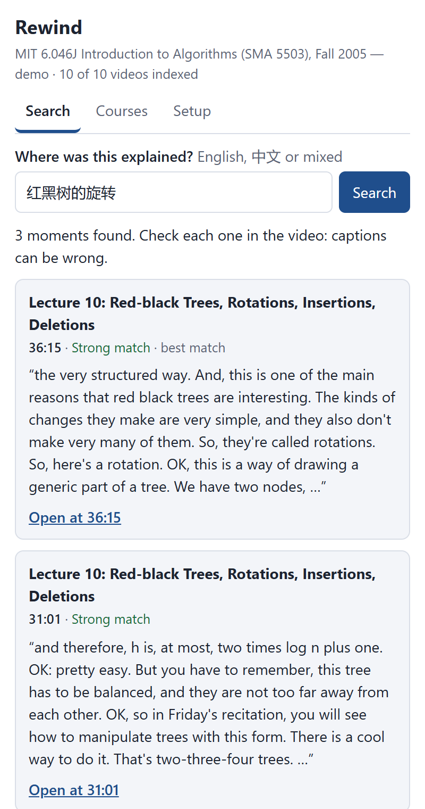
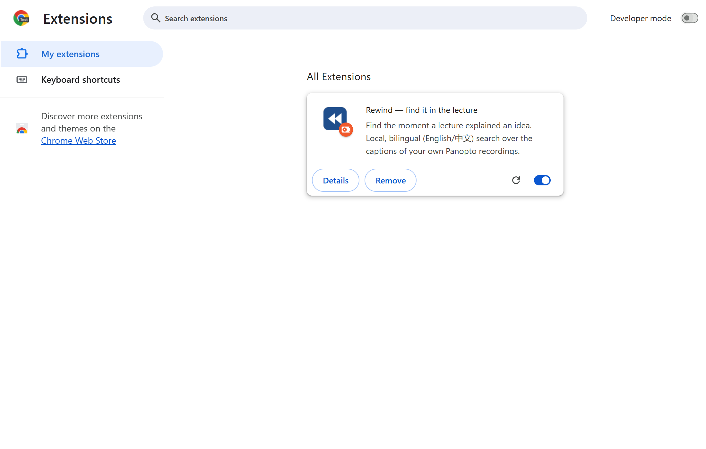
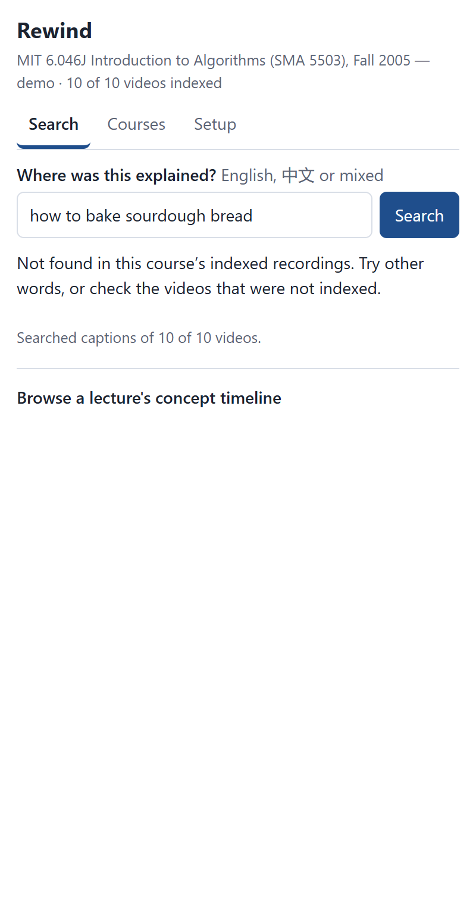
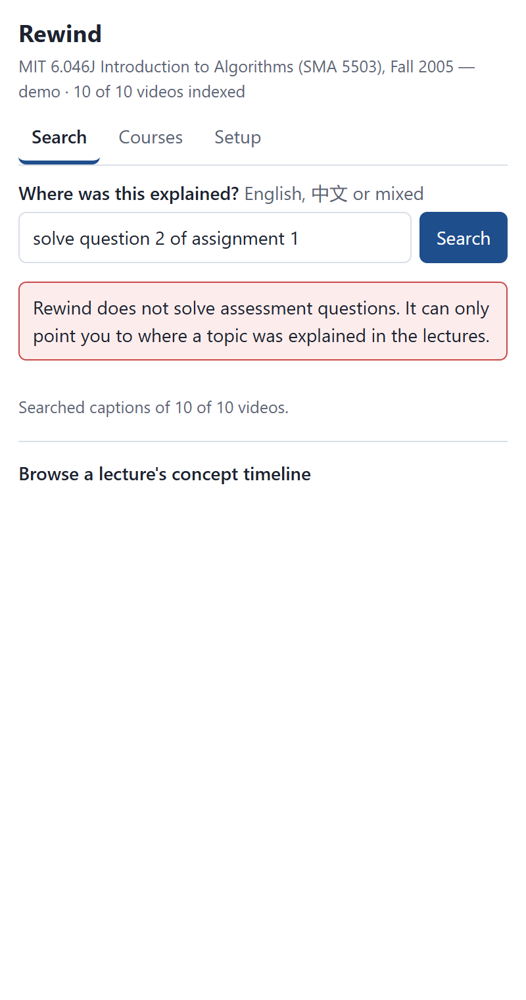
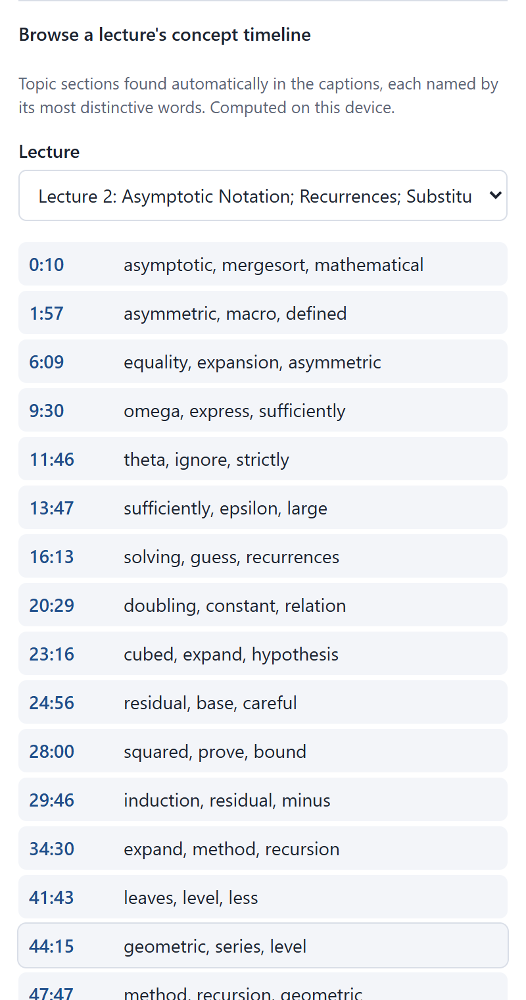

# Rewind

**Find the moment a lecture explained an idea.** Rewind is a Chrome/Edge extension for students who revisit recorded lectures. Ask in English, 中文 or a mix ("why is quicksort fast on average", "主定理怎么用", "master theorem 的三种情况"). Rewind shows up to three moments, each with the video title, a timestamp and the caption excerpt. Clicking one opens the original video at that second.

Search runs on your own computer. The captions, the search index and the embedding model all stay in your browser.

> AILT9019 group project (gp18), v0.2.0. Project page: [docs/index.html](docs/index.html) (publish with GitHub Pages from `/docs`).



---

## Install (no coding needed)

**Option A: install the pre-built release**
1. Download `rewind-v0.2.0.zip` from the GitHub release and unzip it. You get a folder called `rewind-v0.2.0`.
2. Open **chrome://extensions** (Chrome) or **edge://extensions** (Edge).
3. Turn on **Developer mode** (top-right in Chrome, left sidebar in Edge).
4. Click **Load unpacked** and select the `rewind-v0.2.0` folder.
5. Pin Rewind from the puzzle-piece menu, then click its icon. The Rewind side panel opens.



**Option B: build and load from source**
1. Clone or download this repository.
2. In a terminal in the project folder, run:
   ```bash
   npm install
   npm run demo:build -- --model minilm-l12
   npm run build
   ```
3. Open chrome://extensions (or edge://extensions), turn on Developer mode, click **Load unpacked** and select the `dist` folder.

## First use: the demo (no HKU access, no API key)

Rewind opens with a built-in demo course: ten captioned lectures of **MIT 6.046J Introduction to Algorithms (Fall 2005)**, which MIT OpenCourseWare publishes under CC BY-NC-SA 4.0.

1. **Setup** tab → **Download & check model**. This is a one-time download of about 120 MB. Afterwards the model runs offline on your device.
2. **Search** tab → type a question → **Search** (or press Enter).
3. Each result shows the lecture, a timestamp, the caption excerpt and a match label (*Strong match* / *Possible match*; these are not probabilities). **Open at mm:ss** opens the lecture on YouTube at that second. Arrow keys move between results.
4. **Browse a lecture's concept timeline** (below the results) lists each lecture's topic sections, found automatically in the captions, each a link to its start.

If you skip step 1, Rewind still works in **keyword-only mode** and says so in a yellow banner. Exact wording ("master theorem") still finds results, but paraphrased and Chinese questions may be missed.

Example questions: `master theorem` · `shortcut for divide-and-conquer recurrences` · `计数排序是怎么工作的` · `quicksort 的 partition 怎么做` · `how to bake bread` (→ Not found) · `solve question 2 of assignment 1` (→ refused).

| | | |
|---|---|---|
|  |  |  |
| "Not found" instead of a guess | Assessment requests declined | Concept timeline |

## Using it with your Panopto course

> **Ask first.** Being able to see a recording is not permission to copy its captions. Ask the lecturer or course team before indexing HKU material. Never share an HKU index.

1. Open your course's **Panopto folder** (the list of recordings) in a normal tab. If you usually sign in through Moodle, do that first.
2. In Rewind, go to **Courses** → **Index this course**. The first time, Chrome asks to let Rewind read Panopto pages. Rewind asks only for `*.panopto.com` / `*.panopto.eu`.
3. Rewind reads the captions you can already see, then builds the index on your device. It shows progress, how many videos were indexed, and which ones were not indexed and why (*No captions available; this video was not indexed*, *Access refused*, *Broken link*).
4. Searches then cover that course. "Not found" means not found **in the indexed captions**. A folder whose videos have no captions at all shows *Index unavailable* instead.

Rewind uses your existing Panopto session from inside your own tab. It never sees or stores your password, and it never downloads audio or video. **Reindex** updates a course; **Delete** removes its captions, vectors and metadata; **Export** saves it as a `.rewind.json` file (keep HKU exports private).

> **Validation:** the team has tested the Panopto adapter on **HKU's live Panopto**, and it works. It is also covered by automated tests against simulated Panopto responses (`test/unit/panopto.test.js`). It uses the same (undocumented) endpoints as Panopto's own pages, so a future Panopto update could break it. If that happens Rewind reports an error, and the demo keeps working.

## Optional: AI query help (off by default, your own key)

In **Setup → Optional: AI query help** you can add your own **OpenRouter** or **OpenAI** API key. Then:
- **Query rewriting** sends your *question text* to the model, which suggests up to two English search phrasings in lecture vocabulary. Your original question is always searched too, and if the API is slow or fails you get the normal local results.
- **Result labels** send up to *three short result excerpts* (≤ 320 characters) for one-line labels.

Safeguards:
- Both options are off until you tick them.
- The **exact request preview** shows what would be sent for your last question (everything except the key).
- Assessment requests are never sent.
- Excerpts that look personal (emails, phone numbers, student IDs, names) are never sent.
- For Panopto courses, labels stay off unless you tick *External processing permitted for this course* in the Courses tab.
- The key is kept in session storage (cleared when the browser closes, never in page scripts or files) and requests go from the extension, not the Panopto page.

To get a key: OpenRouter at https://openrouter.ai/keys (default model `openai/gpt-4o-mini`), or OpenAI at https://platform.openai.com/api-keys (needs billing set up). Usage is billed by the provider to your own account; we don't promise a free tier.

> Deviation from the proposal: the proposal named OpenAI's Responses API as the planned provider. Both are supported; OpenRouter was added because it is what the team has a key for.

## Privacy and your data

- Captions, indexes and settings are stored only in this browser (IndexedDB and extension storage).
- No analytics, no accounts, no Rewind server. Network requests: the one-time model download from Hugging Face, caption reads from Panopto pages you open yourself, and — only if you turn it on — the optional AI query help above.
- **Setup → Delete all Rewind data** removes every indexed course, all settings and any saved key. **Remove downloaded model** removes the model files.
- **Offline:** cached indexes and the downloaded model work without a network. Opening a video still needs the network and your course login.
- Full policy: [store/privacy-policy.md](store/privacy-policy.md).

## What Rewind does not do

- It does not solve assignment, quiz or exam questions. Requests like "solve question 2 of assignment 1" or "帮我做作业第二题" get a notice, plus at most links to where the topic was explained.
- It does not summarise whole lectures.
- It does not bypass access controls, handle passwords, share captions, or collect usage data.
- Caption text is treated purely as data. Nothing in a caption can change what Rewind does, and excerpts sent for labels are marked as untrusted data.

---

## How it works

```
Panopto folder ─▶ caption track ─▶ 45 s windows, 15 s stride ─┬─▶ keyword index (BM25; Chinese bigrams)
                                                              ├─▶ local multilingual embeddings
                                                              └─▶ topic boundaries (TextTiling-style) ─▶ concept timeline
Question ─▶ assessment check ─▶ [optional AI rewrites] ─▶ keyword + embedding rankings for each phrasing ─▶ reciprocal-rank fusion
         ─▶ similarity threshold ─▶ de-duplicate ─▶ ≤ 3 results  |  "Not found"  |  refusal notice
```

| Part | File |
|---|---|
| Caption parsing (SRT, WebVTT, Panopto JSON) | [src/core/captions.js](src/core/captions.js) |
| Windows, BM25, vectors, fusion, segmentation, snapping | [src/core/](src/core/) |
| Assessment-request check (EN + 中文) | [src/core/guard.js](src/core/guard.js) |
| Search orchestration, statuses, optional rewrite hook | [src/core/search.js](src/core/search.js) |
| Concept timeline | [src/core/timeline.js](src/core/timeline.js) |
| Index export/import (`.rewind.json`) | [src/core/exchange.js](src/core/exchange.js) |
| Embeddings (Transformers.js + ONNX Runtime WebAssembly, in a worker) | [src/embed/](src/embed/) |
| Optional AI client and sensitive-excerpt filter | [src/llm/](src/llm/) |
| Panopto adapter (isolated) | [src/adapters/panopto.js](src/adapters/panopto.js) |
| Local storage and deletion | [src/storage/db.js](src/storage/db.js) |
| Side panel UI | [src/sidepanel/](src/sidepanel/) |
| Retrieval settings (tuned on the practice set) | [src/core/config.js](src/core/config.js) |

### Embedding model: a deviation from the proposal

The proposal names `Xenova/multilingual-e5-small`. Rewind supports it (Setup → Model), but **ships with `Xenova/paraphrase-multilingual-MiniLM-L12-v2` as the default**. Both are pinned to exact Hugging Face revisions, about 120 MB quantised, 384-dimensional.

The default was chosen on the **15-question practice set only** (`npm run eval:tune`): MiniLM reached Hit@3 7/10 (3/4 Chinese/mixed) against e5-small's 5/10 (0/4). With e5-small, scores for correct Chinese matches overlapped with off-topic queries. Two other local options were tried and dropped: `multilingual-e5-base` (no better, twice as slow) and the local translation model `opus-mt-zh-en` (哈希表冲突 → "Hashie's watch"). The frozen test set confirms the trade-off below: MiniLM finds Chinese questions, e5-small says "Not found" more reliably.

Other design notes:
- Topic-start snapping is implemented, but practice-set tuning switched it off (`maxSnap: 0`) because it didn't improve hits.
- Browser and Node embeddings are checked to agree (cosine > 0.99) in the end-to-end test, so the Node evaluation describes what students get.
- ONNX Runtime's WebAssembly files ship inside the extension: Manifest V3 forbids remote code.

---

## Evaluation

Corpus: lectures 1–10 of MIT 6.046J Fall 2005, 12.8 hours of captions, 3,054 windows. Sources, URLs and licences are in [demo/sources.json](demo/sources.json).

| Set | File | Contents |
|---|---|---|
| Test — **double-annotated, reconciled and frozen** | [eval/questions.test.json](eval/questions.test.json) | 12 exact, 12 paraphrased, 12 Chinese/mixed, 8 not covered, 6 assessment |
| Practice (tuning only) | [eval/questions.practice.json](eval/questions.practice.json) | 15 questions on different topics (single-annotated draft) |

**A hit** means a returned start time falls in [agreed start − 30 s, agreed end]. **The baseline** is keyword-only retrieval over the same captions, with its own thresholds tuned on the same practice set.

### Official results (frozen test set, local search, 17 Nov 2026)

Machine: AMD Ryzen 7 250, 16 threads, 31 GB RAM, Windows 11, Node 24. Index build in Node: 59 s (MiniLM) / 71 s (e5-small). Model load from cache: ~1 s (Node), 0.7–1.6 s (browser).

| Frozen test set (50 q) | MiniLM-L12 (default) | e5-small (proposal) | Keyword baseline | Target | Met? |
|---|---|---|---|---|---|
| Exact Hit@3 | 11/12 | 10/12 | 10/12 | — | |
| Paraphrased Hit@3 | 6/12 | 6/12 | 6/12 | ≥ 10/12 and +20 pts | no |
| Chinese/mixed Hit@3 | **8/12** | 1/12 | 0/12 | ≥ 10/12 and +20 pts | +67 pts, but 8/12 |
| Answerable Hit@1 / Hit@3 | 15 / 25 of 36 | 12 / 17 of 36 | 8 / 16 of 36 | — | |
| Not found correct | 3/8 | **7/8** | 5/8 | ≥ 7/8 | e5-small only |
| Refusals | 6/6 | 6/6 | — | 6/6 | yes |
| Median local retrieval | 7 ms (Node) · 12–28 ms (browser, three runs) | 7 ms (Node) | — | < 2 s | yes |

Per-question tables: [eval/results/2026-11-17-test-minilm-l12.md](eval/results/2026-11-17-test-minilm-l12.md), [eval/results/2026-11-17-test-e5-small.md](eval/results/2026-11-17-test-e5-small.md). Earlier numbers on draft annotations are kept in `eval/results/provisional-2026-10-22/` for the record.

Honest reading: refusals (with no false refusals) and latency are met by a wide margin; paraphrased questions show no gain over keywords; Chinese/mixed improves hugely over keywords but stays below 10/12; "Not found" is met only by e5-small, and MiniLM's practice-tuned threshold is too permissive (the practice set has only 3 not-covered questions). These results were seen before v0.2 was built; v0.2 did not change local search (checked by `npm run eval:regress`, which must reproduce the official records exactly).

### With optional AI query rewriting (reported separately)

<!-- LLM_RESULTS -->
| Frozen test set | + AI rewriting | Local only |
|---|---|---|
| Exact wording, Hit@3 | 11 / 12 | 11 / 12 |
| Paraphrased, Hit@3 | 6 / 12 | 6 / 12 |
| Chinese / mixed, Hit@3 | 8 / 12 | 8 / 12 |
| All answerable, Hit@1 / Hit@3 | 19 / 25 of 36 | 15 / 25 of 36 |
| Not covered → “Not found” | 5 / 8 | 3 / 8 |
| Assessment requests refused (never sent to the API) | 6 / 6 | 6 / 6 |
| Median local retrieval time (Node) | 29 ms | 7 ms |
| Median API latency (separate, not in the local target) | 1105 ms | — |

Rewriting model openrouter: openai/gpt-4o-mini; settings tuned on the practice set only; 0 API error(s) on the test set (those questions fell back to local search).
<!-- /LLM_RESULTS -->

### Optional local Whisper transcription (not an MVP gate)

`tools/whisper/` transcribes **licensed or explicitly authorised media only**, locally, with `Xenova/whisper-base.en`:

```bash
npm run whisper -- ocw-6046-f05-l02 --from 0 --to 600           # entries in tools/whisper/licensed-media.json
npm run whisper -- --url <https://...> --permission "<who allowed it, when>"   # anything else needs recorded permission
npm run whisper:wer -- tools/whisper/output/ocw-6046-f05-l02-0-600.vtt demo/raw/lecture-02.vtt --from 0 --to 600
node demo/build-demo.mjs --captions-from 2=tools/whisper/output/<file>.vtt   # use a transcript for one lecture
```

- The media is downloaded to a private temporary folder, decoded with ffmpeg (must be on PATH), and the temporary copy is always deleted.
- Output is WebVTT headed *Machine-transcribed; not verified*, plus the licence or permission note, and results from it show that label.
- Unusable output (too few words, repetition loops) is rejected with a notice.

**Measured:**
- Sample: first 10 minutes of the licensed MIT lecture 2 video.
- Speed: 7.4× real time on the machine above.
- **WER: 25.9%** against MIT's published captions ([eval/results/whisper-wer.json](eval/results/whisper-wer.json)). Those captions are lightly edited rather than verbatim, so this overstates the true error.
- No comparison with Panopto captions is claimed.

### Team workflow

```bash
node eval/transcript.mjs grep 2 "master (method|theorem)"   # search the raw transcripts (not Rewind's output)
node eval/annotate.mjs status test                          # record / reconcile / agree / freeze, see eval/annotate.mjs
npm run eval:split                    # fails if practice and test questions are near-duplicates
npm run eval:tune -- --write          # tune on the practice set only
npm run eval -- --set test            # official local results → eval/results/<date>-test-<model>.{json,md}
npm run eval:regress                  # local search must reproduce the official records exactly
npm run eval:llm                      # optional AI mode (needs .env key), reported separately
```

Browser latency: open `chrome-extension://<id>/bench/bench.html` after downloading the model, or run `npm run test:e2e`.

---

## Agent skill (Pi and other Agent-Skills agents)

[skills/rewind-search/](skills/rewind-search/) is an Agent Skill (`SKILL.md` + one self-contained script) for Pi and compatible coding agents (Claude Code, Codex CLI, …). It searches an exported `.rewind.json` course index with the same search, refusal and "Not found" behaviour as the extension, and prints timestamped links.

```bash
# install: copy the folder to ~/.pi/agent/skills/ (or .pi/skills/ in a project)
node skills/rewind-search/scripts/search.mjs --index my-course.rewind.json "主定理怎么用"
```

It needs only Node for keyword search. Where `@huggingface/transformers` is installed it uses the index's embedding model too. To try it, `node scripts/build-skill.mjs --export-demo release/demo-mit-6046j.rewind.json` exports the demo index.

## Chrome Web Store pack

[store/](store/) holds the listing text, permission justifications, data-use answers, privacy policy, five 1280×800 screenshots and the 440×280 promo tile ([store/listing.md](store/listing.md)). Submitting it as an unlisted item needs a team member's Chrome Web Store developer account.

## For developers

```bash
npm install                                # install dependencies
npx playwright install chromium            # browser for the end-to-end tests
npm run demo:build -- --model minilm-l12   # fetch OCW captions, build the demo index (also --model e5-small)
npm test                                   # 83 unit tests (Vitest)
npm run build                              # → dist/ (load unpacked) + the agent skill bundle
npm run test:e2e                           # Playwright: loads dist/ in Chromium, drives the side panel (3 tests)
npm run screenshots                        # regenerate docs/img and store screenshots
npm run package                            # → release/rewind-v0.2.0.zip
```

- **Pinned versions:** `@huggingface/transformers` 3.8.1; model revisions are in [src/embed/embedder.js](src/embed/embedder.js) and [tools/whisper/transcribe.mjs](tools/whisper/transcribe.mjs).
- **e2e profile:** the first e2e run downloads the model once into `.cache/e2e-profile`. Another test blocks Hugging Face to simulate an absent model cache offline. A third covers the timeline, export/import, the consent preview and AI query help against a mocked OpenRouter.

## Licences and credits

- **Demo content:** MIT OpenCourseWare 6.046J Fall 2005 (Prof. Charles Leiserson, Prof. Erik Demaine), CC BY-NC-SA 4.0. See [demo/LICENSE-DEMO.md](demo/LICENSE-DEMO.md). MIT OCW does not endorse Rewind.
- **Models:** `Xenova/paraphrase-multilingual-MiniLM-L12-v2` (Apache-2.0), `Xenova/multilingual-e5-small` (MIT), `Xenova/whisper-base.en` (MIT); see their model cards.
- **Code licence:** to be chosen by the team.
- **AI assistance:** this implementation was built with the help of an AI coding assistant (Claude Code). This will be disclosed in the final report, as the proposal commits to.
